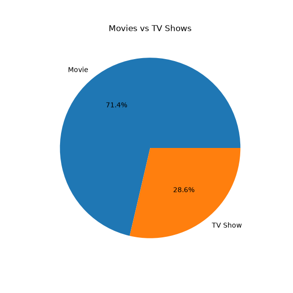
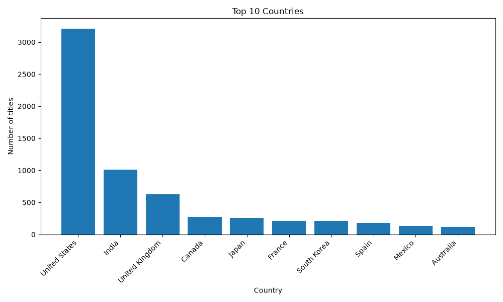
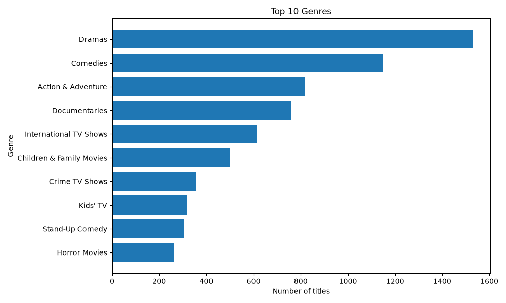
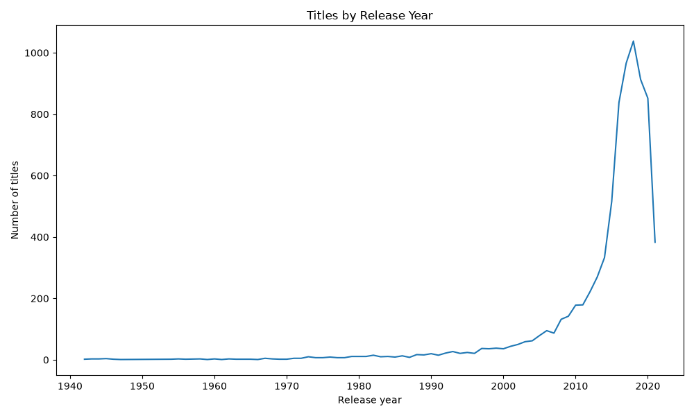

# Netflix Content Analysis

Python data analysis project that explores Netflix movies and TV shows: content type, top countries, popular genres and release year trends.

## Tools Used
- Python
- Pandas (data cleaning and analysis)
- Matplotlib (data visualization)

## Dataset
Netflix Movies and TV Shows dataset from Kaggle (8,807 titles, 12 columns).

## What I Did
1. Loaded the dataset and checked its shape, columns and missing values
2. Removed rows with missing country (831 rows), leaving 7,976 titles
3. Took the first listed country and genre of each title
4. Found key insights and plotted 4 charts

## Key Insights
- Total titles analysed: 7,976
- Movies: 5,691 (71.4%) | TV Shows: 2,285 (28.6%)
- Countries covered: 86
- Most common genre: Dramas
- Top countries: United States, India, United Kingdom

## Charts

### Movies vs TV Shows

### Top 10 Countries

### Top 10 Genres

### Titles by Release Year

## How to Run
1. Install the libraries: `pip install pandas matplotlib`
2. Keep `netflix_titles.csv` in the same folder as `analysis.py`
3. Run: `python analysis.py`

## Limitation
For titles with more than one country or genre, only the first one is used.
